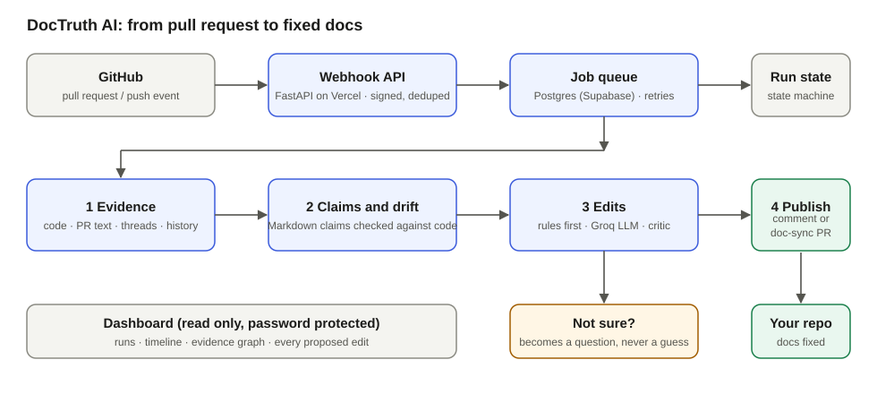
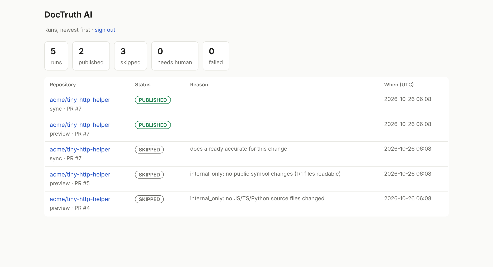
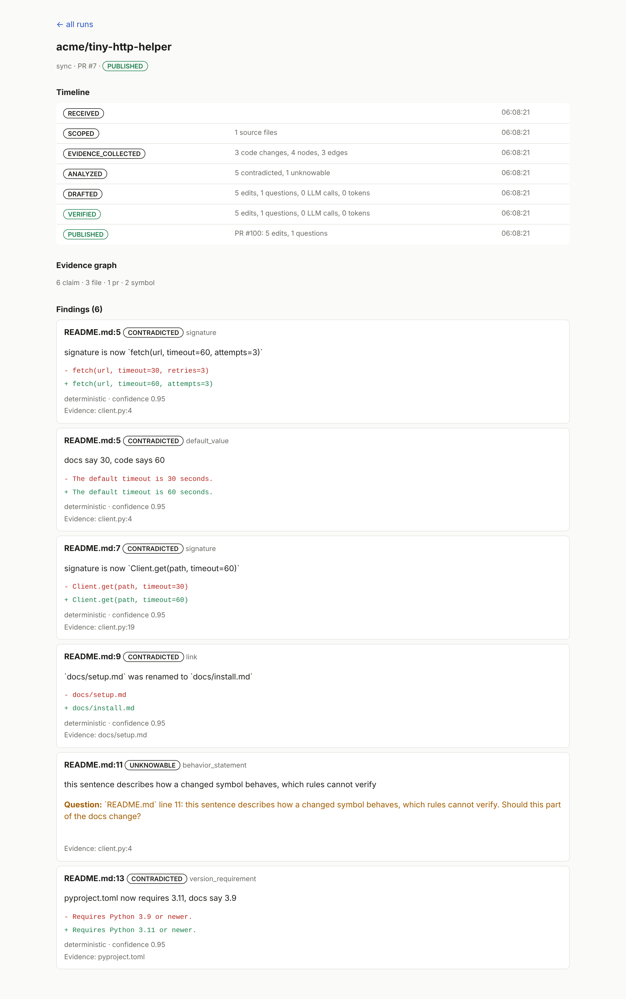
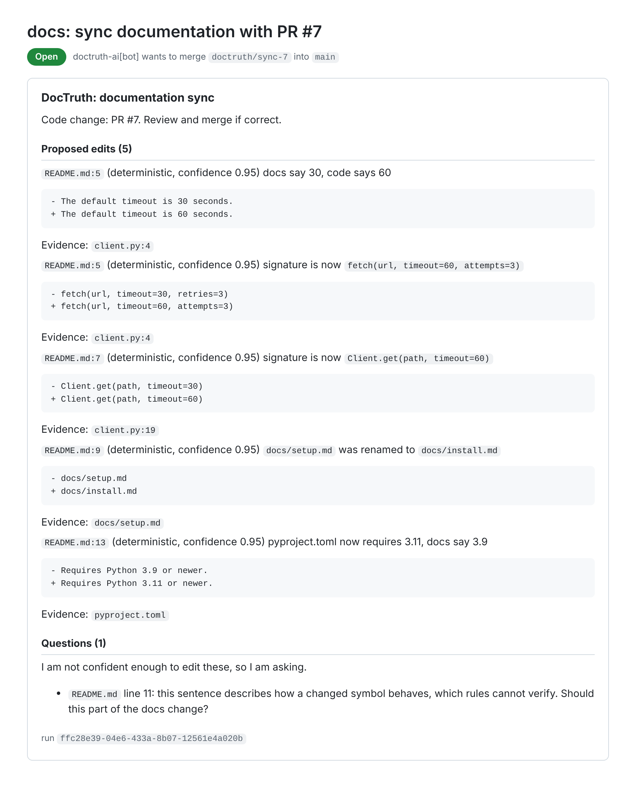
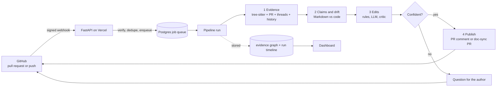
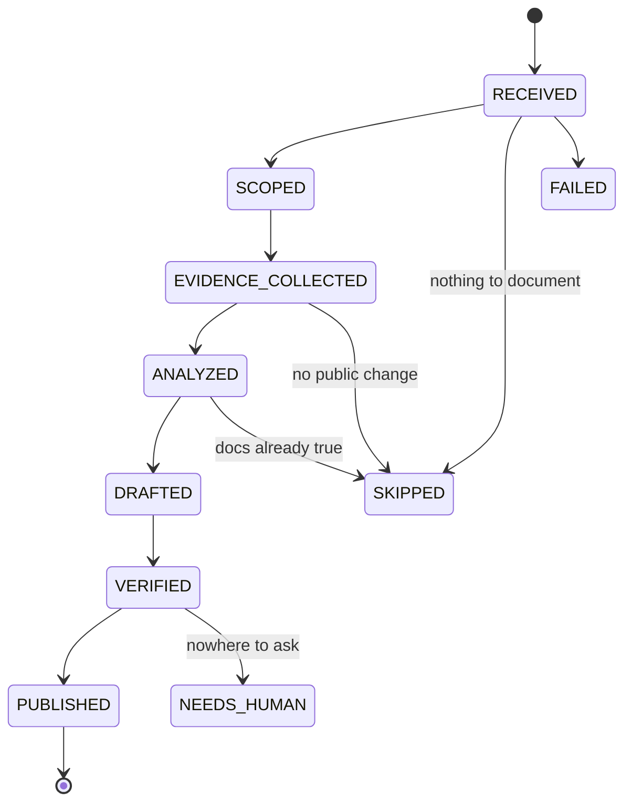
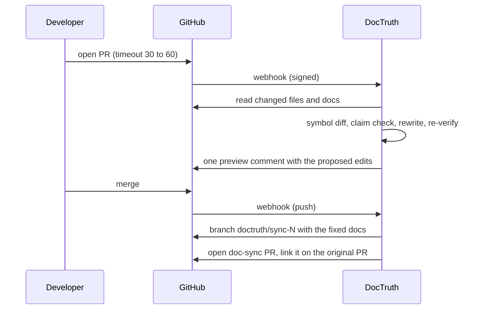

<div align="center">

# 📄 DocTruth AI

### A GitHub App that reads every pull request and **fixes the documentation the code just made false**, with evidence, or asks when it is not sure.


**[🚀 Live app](https://doctruth-ai.vercel.app/health)** &nbsp;·&nbsp; [How it works](#how-it-works) &nbsp;·&nbsp; [Deploy free](#deploy-free) &nbsp;·&nbsp; [Dashboard](#dashboard) &nbsp;·&nbsp; [Design decisions](#design-decisions)



</div>

---

## Table of contents
1. [What it does](#what-it-does)
2. [Features](#features)
3. [Screenshots](#screenshots)
4. [How it works](#how-it-works)
5. [What it checks](#what-it-checks)
6. [Design decisions](#design-decisions)
7. [Reliability and security](#reliability-and-security)
8. [Tech stack](#tech-stack)
9. [Project structure](#project-structure)
10. [Endpoints](#endpoints)
11. [Configuration](#configuration)
12. [Run locally](#run-locally)
13. [Tests and benchmark](#tests-and-benchmark)
14. [Deploy free](#deploy-free)
15. [Demo script](#demo-script)
16. [Known limits](#known-limits)
17. [Roadmap](#roadmap)
18. [Skills demonstrated](#skills-demonstrated)
19. [Author](#author)

---

## What it does
Documentation rots: someone changes a default, renames a function or bumps a Python version, and the README keeps saying the old thing.

DocTruth is installed on a repository. For every pull request it:

1. reads the **code change** (which public symbols changed, and how),
2. gathers **evidence** around it (PR text, review threads, commit history),
3. checks every **claim in the Markdown docs** against that evidence,
4. proposes the exact **fix**, cites the evidence for it, and checks the fix again before it is shown,
5. publishes it where a human can review it: a **comment** on the open PR, then a **doc-sync pull request** after the merge.

If it is not confident enough, it does **not** edit. It asks a question instead.

> **Real run on this repository:** `demo.py` changed the default `timeout` from 90 to 120 while the README still said 30. DocTruth opened a pull request on its own branch `doctruth/sync-…` fixing both lines (the sentence about the default and the `fetch(...)` call), each with a pointer to the changed line of code.

## Features
| Area | What you get |
|---|---|
| **Evidence graph** | Code symbols, files, commits, PRs, review threads and claims are stored as nodes and edges per run, so every edit can be traced back |
| **Deterministic first** | Defaults, signatures, renames, CLI flags, links and version numbers are fixed by plain rules; the LLM is only for prose and code examples |
| **LLM with a critic** | An LLM edit must cite evidence, stay close to the original, invent no symbol or path, and pass a separate critic prompt |
| **Ask, don't guess** | Anything below the confidence threshold, or removed upstream, becomes a question for the author |
| **Honest source ranking** | Code beats discussion for behaviour; resolved threads are decisions, unresolved threads are open questions, never facts; a revert caps confidence |
| **Two publishing modes** | A single, self-updating preview comment on open PRs; a doc-sync PR (branch `doctruth/sync-<n>`) after merge |
| **Idempotent** | Re-running updates the same comment and the same PR; edits whose text changed since analysis are not applied |
| **No new infrastructure** | Postgres job queue (no Redis), runs on Vercel and Supabase free tiers |
| **Read-only dashboard** | Runs, state timeline, evidence counts and every proposed edit, behind a password |
| **Benchmark** | 20 labelled cases with precision, recall and false-edit counts, gated in tests |
| **Safe by default** | Signed webhooks, secret scrubbing, untrusted-data prompts, `DRY_RUN` kill switch |

## Screenshots
Generated by running the real pipeline and dashboard on a sample repository (`acme/tiny-http-helper`), so no private data is shown.

**Dashboard:** every run, newest first, with status counts.



**Run detail:** the state timeline, the evidence graph counts and each finding with its before and after text.



**The doc-sync pull request** the bot opens after a merge: five corrected lines, each with its evidence, and one question for a sentence rules cannot verify.



## How it works



### The run state machine

Every transition is stored with a note, so a run can be replayed in the dashboard.

### One change, step by step


## What it checks
Python, JavaScript and TypeScript code is compared symbol by symbol (tree-sitter) and matched against claims in Markdown files in the repository root and in `docs/`.

| Claim type | Example | Typical fix |
|---|---|---|
| Signature | a code span showing a call with arguments | current parameters, or the new name after a rename |
| Default value | a sentence saying what a default is | new value, unit kept (`30s` becomes `60s`) |
| CLI flag | a shell line with a flag and a value | new flag default |
| File path or link | a link to a file that moved | new relative path |
| Version requirement | "Requires Python 3.9" | version from `pyproject.toml` or `package.json` |
| Code example | a fenced block that uses a removed parameter | LLM rewrite, re-checked against the new signature |
| Behaviour statement | prose about a changed function | LLM judges against the evidence, otherwise a question |

A line that already holds a precise claim is never also reported as a vague behaviour claim, which keeps the noise down.

## Design decisions
- **Rules first, LLM last.** Anything that can be derived mechanically is derived mechanically. The model sees only what rules cannot decide, and it never has the last word: its edit is checked again by code.
- **Ask, don't guess.** A wrong silent edit in documentation is worse than a question. The confidence threshold is 0.8.
- **Every edit carries evidence.** The edit stores the ids of the evidence nodes that justify it, plus the method (`deterministic` or `llm`) and the prompt versions.
- **Untrusted by construction.** Repository text reaches the LLM wrapped as untrusted data; secrets are scrubbed before they leave; the dashboard escapes everything and sends a strict CSP.
- **Idempotence over cleverness.** The bot branch is reset to the analysed commit on each run, comments and PRs are found by a hidden marker, and a job has a dedupe key, so webhooks arriving twice are harmless.
- **No infrastructure to babysit.** A Postgres queue with `FOR UPDATE SKIP LOCKED`, retries with backoff and dead jobs replaces Redis; the API wakes the worker itself and a daily cron is the safety net.
- **Measured, not assumed.** A labelled benchmark guards against regressions, and the first run of it found a real noise bug.

More detail per phase is in [docs/DECISIONS.md](docs/DECISIONS.md).

## Reliability and security
**Reliability**
- Jobs retry with exponential backoff; after the last attempt a FAILED run keeps the failure visible
- A job stuck in `running` is reclaimed after 5 minutes
- A serverless time budget stops new jobs from starting late in an invocation; the rest stay queued
- The LLM client retries, falls back to a second model, repairs broken JSON once, and has a call budget per run; if the LLM is down the run still finishes with rules and questions
- Branches starting with `doctruth/` are ignored, so merging the bot's PR cannot loop

**Security and privacy**
- Webhooks are verified with HMAC and deduplicated by delivery id; oversized payloads are rejected before parsing
- Secrets (database URL, private key, API keys) live only in environment variables; error text is scrubbed before it is stored
- GitHub App permissions are limited to Contents, Pull requests and Metadata
- The dashboard is read only, password protected, and has no state-changing buttons
- `DRY_RUN=true` analyses and stores everything but writes nothing to GitHub

## Tech stack
| Layer | Technology |
|---|---|
| Backend | Python, FastAPI, Pydantic v2, async SQLAlchemy 2, Alembic, `httpx` |
| Code analysis | tree-sitter (Python, JavaScript, TypeScript) |
| AI | Groq API, `openai/gpt-oss-120b` with `openai/gpt-oss-20b` fallback, versioned prompt files |
| Database and queue | Postgres on Supabase (transaction pooler), job queue in SQL |
| GitHub | GitHub App (JWT then installation token), REST and GraphQL |
| Hosting | Vercel Hobby (serverless API, dashboard, daily cron) |
| Quality | pytest, offline benchmark |

## Project structure
```
doctruth-ai/
├── docs/
│   ├── ARCHITECTURE.md  DEPLOY.md  DECISIONS.md  ROADMAP.md  CHECKLIST.md
│   └── images/                     # diagram and screenshots
├── backend/
│   ├── index.py                    # Vercel entry point
│   ├── vercel.json                 # daily cron
│   ├── alembic/                    # database migrations
│   ├── app/
│   │   ├── main.py
│   │   ├── api/                    # webhooks, job runner, dashboard, health
│   │   ├── github/                 # app auth, REST/GraphQL client, event handling
│   │   ├── workers/                # Postgres queue, job processing
│   │   ├── evidence/               # symbols, code, discussion, history, graph
│   │   ├── claims/                 # Markdown claim extraction, drift checks
│   │   ├── pipeline/               # run driver, rewrite, reasoning, publishing
│   │   ├── llm/                    # client, schemas, scrubber, prompts/
│   │   ├── models/                 # SQLAlchemy tables
│   │   └── eval/                   # benchmark cases and runner
│   └── tests/                      # 119 tests, no network, no LLM
└── README.md
```

## Endpoints
| Method | Path | Purpose |
|---|---|---|
| `POST` | `/webhooks/github` | GitHub webhook receiver (signature required) |
| `GET` `POST` | `/internal/jobs/run` | Runs queued jobs (protected by `CRON_SECRET`; also called by the daily cron) |
| `GET` | `/health` | Liveness |
| `GET` | `/dashboard` | Runs list (login page if not signed in) |
| `GET` | `/dashboard/runs/{id}` | One run: timeline, evidence counts, findings |
| `POST` | `/dashboard/login`, `GET` `/dashboard/logout` | Dashboard session |
| `GET` | `/api/runs` | Runs and status counts as JSON (cookie or bearer token) |

Database tables: `installations`, `repositories`, `webhook_deliveries`, `jobs`, `runs`, `run_transitions`, `evidence_nodes`, `evidence_edges`.

## Configuration
Set these as environment variables (Vercel project settings, or a local `.env`; see `.env.example`).

| Variable | Required | Default | Notes |
|---|---|---|---|
| `DATABASE_URL` | yes | local SQLite | Postgres connection string (Supabase transaction pooler) |
| `GITHUB_APP_ID` | yes | - | Numeric app id |
| `GITHUB_APP_PRIVATE_KEY` | yes | - | PEM text (or base64 of it) |
| `GITHUB_WEBHOOK_SECRET` | yes | - | Same secret as in the GitHub App |
| `CRON_SECRET` | yes | - | Protects the job runner |
| `PUBLIC_BASE_URL` | yes | - | Your deployed URL, used by the worker trigger |
| `DASHBOARD_TOKEN` | no | - | Dashboard password; empty means the dashboard is closed |
| `GROQ_API_KEY` | no | - | Without it only rule-based edits and questions are produced |
| `LLM_MODEL`, `LLM_FALLBACK_MODEL` | no | `openai/gpt-oss-120b`, `openai/gpt-oss-20b` | Main and fallback model |
| `CONFIDENCE_THRESHOLD` | no | `0.8` | Below this an edit becomes a question |
| `LLM_MAX_CALLS` | no | `12` | LLM calls allowed per run |
| `DRY_RUN` | no | `false` | Analyse and store, write nothing to GitHub |
| `JOB_TIME_BUDGET_S` | no | `40` | Stop starting new jobs after this many seconds |
| `MAX_WEBHOOK_BYTES` | no | `5000000` | Larger payloads are rejected |

## Run locally
```bash
git clone https://github.com/muhammadhunzla971-sys/doctruth-ai.git
cd doctruth-ai/backend

python -m venv .venv
source .venv/bin/activate          # Windows PowerShell: .venv\Scripts\Activate.ps1
pip install -r requirements-dev.txt

alembic upgrade head               # creates the tables
uvicorn app.main:app --reload --port 8000
```
To receive real webhooks you need the GitHub App and a public URL; see [docs/DEPLOY.md](docs/DEPLOY.md). The tests and the benchmark need none of that.

## Tests and benchmark
```bash
cd backend
pytest -q                     # 119 tests: webhook, queue, evidence, claims, LLM, publishing, dashboard, hardening
python -m app.eval.run        # 20 labelled cases
```
- Tests use in-memory fakes for GitHub and the LLM, so they need no network and no keys
- The benchmark runs the real extract, drift, rewrite and verify code on hand-labelled cases (15 expect an edit or a question, 5 expect that nothing is touched) and reports edit precision, edit recall, false edits and noise questions; the test suite fails if any false edit appears
- The first benchmark run found a real bug (a correct sentence raised a pointless question), which is now fixed

## Deploy free
Full steps are in [docs/DEPLOY.md](docs/DEPLOY.md). In short:
1. **Supabase:** create a project, copy the transaction pooler string, run `alembic upgrade head` against it.
2. **GitHub App:** webhook URL `https://<your-app>.vercel.app/webhooks/github`, permissions Contents and Pull requests read and write, events Pull request and Push, generate a private key, install it on your repositories.
3. **Vercel:** import the repository, set the root directory to `backend`, add the environment variables above, deploy. Every `git push` redeploys.
4. Open `/health`, then `/dashboard`.

## Demo script
1. Install the app on a small repository whose README mentions a default value and a function call.
2. On a branch, change that default and open a pull request.
3. Within a minute the PR gets **one** DocTruth comment listing the exact edits, each with its evidence.
4. Merge the PR. A `docs: sync documentation with …` pull request appears with the fixed lines.
5. Open the dashboard and click the run: timeline, evidence counts, before and after.
6. Change something DocTruth cannot decide (a vague sentence about a function) and see a question instead of an edit.

## Known limits
- Only Markdown in the repository root and in `docs/` is analysed, up to 20 files per run
- The code analysis covers Python, JavaScript and TypeScript
- The dashboard has a single shared password and is read only
- Rewriting prose depends on the LLM; without a key those claims become questions
- The benchmark is small and synthetic: it guards against regressions but does not prove accuracy on arbitrary repositories
- Vercel Hobby limits function time, so very large pull requests are truncated (and the run says so)

## Roadmap
- [ ] Per-repository settings file (ignore paths, threshold, comment-only mode)
- [ ] Daily LLM budget per installation, shown on the dashboard
- [ ] Propose new sections for undocumented public symbols
- [ ] Close a doc-sync PR automatically when later changes make its edits obsolete
- [ ] Accept and reject buttons in the dashboard
- [ ] Response cache keyed by file hash
- [ ] External link checking
- [ ] More languages for the symbol extractor
- [ ] A larger benchmark built from real pull requests, including a scored LLM path

## Skills demonstrated
- **AI engineering:** LLM as a constrained component, critic pass, evidence-grounded generation, prompt versioning, secret scrubbing and injection-aware prompts, a benchmark that gates changes
- **Backend:** async Python, FastAPI, SQLAlchemy 2 and Alembic, a Postgres job queue with retries and dead jobs, a run state machine, idempotent publishing
- **Program analysis:** tree-sitter symbol extraction and diffing, rename detection, claim extraction from Markdown
- **GitHub platform:** GitHub App authentication, webhook verification, REST and GraphQL, branches, pull requests and comments written as a bot
- **Security and reliability:** HMAC verification, least-privilege permissions, scrubbed errors, size limits, CSP, kill switch, time budgets on serverless
- **DevOps:** free-tier deployment on Vercel and Supabase, scheduled safety-net job

## Author
**Muhammad Hunzla Ishfaq**, BS Artificial Intelligence (2022-2026), Junior Python Developer and aspiring AI Engineer.
GitHub: [@muhammadhunzla971-sys](https://github.com/muhammadhunzla971-sys)

If you like this project, a ⭐ on the repo is very welcome.
